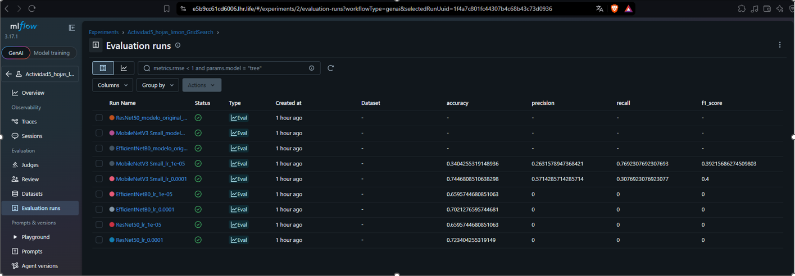

# Actividad 5: Clasificación de hojas de limón con Transfer Learning

## Descripción

Proyecto de clasificación binaria de imágenes de hojas de limón para identificar si están sanas o enfermas. Se utilizaron modelos preentrenados mediante Transfer Learning y se compararon sus resultados.

## Modelos evaluados

- ResNet50
- EfficientNetB0
- MobileNetV3 Small

También se realizó una búsqueda de hiperparámetros (*Grid Search*) variando la tasa de aprendizaje y se registraron los experimentos con MLflow.

## Datos

Se utilizó el conjunto de imágenes *Healthy vs Diseased Leaf Image Dataset*, tomando las imágenes correspondientes al limón (Lemon, P10).

El subconjunto contiene 236 imágenes:
- 159 de hojas sanas
- 77 de hojas enfermas

**Fuente del dataset:** [amandam1/healthy-vs-diseased-leaf-image-dataset](https://www.kaggle.com/datasets/amandam1/healthy-vs-diseased-leaf-image-dataset)

Los datos se descargaron y procesaron en Google Colab. No se incluyen las imágenes en este repositorio.

## Ejecución

1. Abrir el notebook `fuentes/Actividad_5.ipynb` en Google Colab.
2. Descargar el dataset desde la fuente indicada en la sección Datos.
3. Ejecutar las celdas en orden para preparar los datos, entrenar los modelos, evaluar su desempeño y registrar los experimentos en MLflow.

## Resultados

En la evaluación inicial, EfficientNetB0 obtuvo el mejor desempeño general. En el Grid Search, MobileNetV3 Small con una tasa de aprendizaje de 0.0001 obtuvo el mejor F1 para la clase enferma entre las configuraciones evaluadas.

Los resultados completos, métricas y limitaciones se describen en el reporte de la actividad.

## Estructura del repositorio

- `fuentes/`: notebook utilizado para el desarrollo y entrenamiento.
- `datos/`: carpetas destinadas a organizar los datos, si se incluyen localmente.
- `CHANGELOG.md`: registro de cambios del proyecto.

## Herramientas

Python, TensorFlow/Keras, scikit-learn, MLflow y Google Colab.

## Seguimiento de experimentos con MLflow

Se utilizó MLflow para registrar los parámetros y métricas de las configuraciones evaluadas durante el Grid Search, así como los modelos originales entrenados.

## Modelos entrenados

Los modelos guardados en formato Keras (`.keras`) son:

- [ResNet50](modelos/ResNet50.keras)
- [EfficientNetB0](modelos/EfficientNetB0.keras)
- [MobileNetV3_Small](modelos/MobileNetV3 Small.keras)
